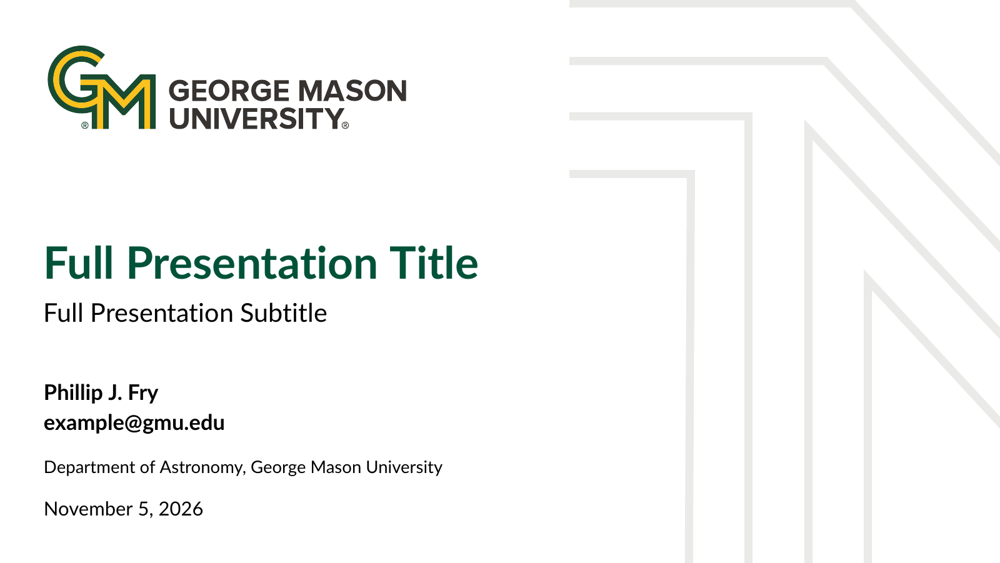

# GMUBeamer



A Beamer template that follows George Mason University's branding guidelines.
It is adapted from the MU Beamer theme by Vít Novotný (Masaryk University).

`main.tex` is a complete example presentation that shows every feature below.

## Getting started

1. Copy `beamerthemeGMU.sty` and the `branding/` folder next to your `.tex` file.
2. Load the theme in your preamble:

   ```latex
   \documentclass[aspectratio=169]{beamer}
   \usepackage[T1]{fontenc}
   \usetheme{GMU}
   ```

3. Compile with pdfLaTeX, for example `latexmk -pdf main.tex`.

The theme is designed for 16:9 slides (`aspectratio=169`).

### Requirements

A recent TeX Live or MiKTeX distribution with these packages: `lato`,
`sansmathfonts`, `tikz`, `etoolbox` and `amsmath`.

## Features

### Look and feel

- GMU green and gold colors, with the Lato font for text and a matching
  sans-serif font for math.
- A title slide with the GMU logo and a subtle background graphic.
- A footer on the gold GMU banner with the author, short title, date and
  page number.
- A clean header: no section or subsection navigation at the top of the slides.
- An outline with numbered sections and subsections.

### Theme option: font scale

Scale the text font up or down with the `scale` option (default `1`):

```latex
\usetheme[scale=0.95]{GMU}
```

This scales the text font only, not math.

### Replacing the title slide logo

```latex
\replacelogo{branding/my-logo.pdf}          % same height as the GMU logo
\replacelogo[1.5cm]{branding/my-logo.pdf}   % custom height
```

Use it in the preamble, after `\usetheme{GMU}`.

### Section slides

`\SectionPage` creates a centered slide with the name of the current section
and an optional subtitle. It has no footer and is not counted in the page
numbers.

```latex
\section{Results}
\SectionPage[What we found]
```

### Side block slides

The `sideblock` frame option covers the right third of the slide with a green
panel. Put the main content in `leftblock` and the panel content in
`rightblock`, which takes a title shown next to the frame title. This works well
for conclusions, references with acknowledgements, or contact details.

```latex
\begin{frame}[sideblock]{Bibliography}
\begin{leftblock}
  Main content, kept clear of the green panel.
\end{leftblock}%
\begin{rightblock}{Acknowledgements}
  White text on the green panel.
\end{rightblock}
\end{frame}
```

Start `rightblock` right after `\end{leftblock}`, with no blank line in
between, so that the two blocks sit side by side. Use `\begin{rightblock}{}`
for a panel without a title.

### Closing slide

`\makeoutro` adds a final green slide with the GMU logo. It is not counted in
the page numbers.

### Standard Beamer features

Blocks (`block`, `exampleblock`, `alertblock`), numbered figure and table
captions, footnotes, `[plain]` slides without footer, and `thebibliography`
all work and are styled to match the theme.

## Credits

Adapted for George Mason University by Javier Almonacid from the MU Beamer theme
by Vít Novotný and Aleš Křenek, Masaryk University.

## License

This work may be distributed and/or modified under the conditions of the
[LaTeX Project Public License](https://www.latex-project.org/lppl/), either
version 1.3 of this license or (at your option) any later version. See
[LICENSE](LICENSE) for the full text.
